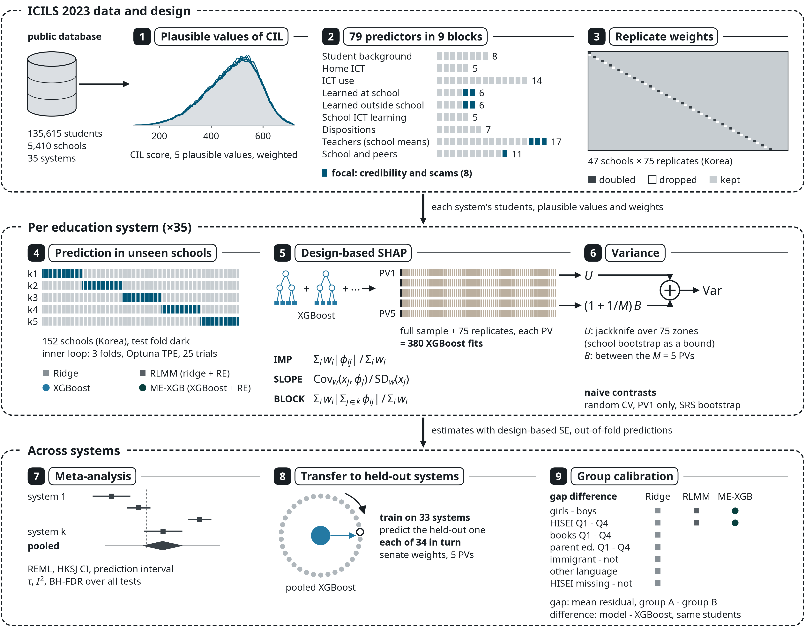

# Design-Based Explainable Machine Learning for Computer and Information Literacy across 35 Education Systems in ICILS 2023

This repository implements a design-based explainable machine-learning framework for computer and
information literacy (CIL) and applies it to all 35 education systems of ICILS 2023 (135,615
students in 5,410 schools). The framework compares four model classes under nested school-grouped
cross-validation and recomputes the SHAP explanations of XGBoost for every plausible value and every
jackknife replicate of the sampling design, so that each explanation carries a design-based standard
error. It sets the explanations against design-based linear estimates of the same associations,
pools them across systems by random-effects meta-analysis and checks, by simulation, which variance
estimator gives calibrated uncertainty for a learner that is refitted over the replicates. The
analysis is associational: it describes what fitted models and survey regressions show about
opportunities to learn credibility evaluation and scam recognition, and it estimates no causal
effect of any intervention.

[](assets/figure-01.png)

*Overview of the method: the ICILS 2023 data and sampling design, the analysis within each of the
35 education systems and the synthesis across systems.*

## What the study measures

- **Prediction gain of a tree ensemble.** Under nested school-grouped cross-validation, XGBoost
  raises the pooled out-of-sample R² of weighted ridge regression by 0.023 (95% CI 0.018 to 0.028).
- **Opportunities to learn outside school.** After adjustment for background, technology use and
  dispositions, the six outside-school items remain associated with CIL at 5.88 points per standard
  deviation (4.87 to 6.89).
- **Opportunities to learn at school.** The association of the six at-school items falls from 3.25
  to 1.33 points per standard deviation (0.27 to 2.39) once dispositions enter the model.
- **One robust focal predictor.** Of the eight focal predictors, only the SHAP slope of learning
  outside school to recognise scams remains significant after Holm adjustment (4.15 points per
  standard deviation, 3.23 to 5.08).
- **Calibration of the variance estimators.** In a pseudo-population simulation, jackknife standard
  errors of SHAP slopes are a median 1.34 times the true value and school-bootstrap ones 0.80 times:
  the jackknife is conservative and the school bootstrap overconfident.
- **Validation of the design-based estimation.** Computed CIL means agree with the IEA's published
  means of all 34 reported systems within 0.5 points, with standard-error ratios of 0.98 to 1.03.

## Repository layout

```
assets/                       overview of the method (figure-01.png)
code/                         the analysis pipeline, one step per script
  config.py                   paths, seed, plausible values, weights, the 79-predictor dictionary
  labels.py                   short labels of the 79 predictors
  countries.py                names of the 35 education systems
  models.py                   weighted ridge, random-intercept model, XGBoost, mixed-effects XGBoost
  survey.py                   jackknife variance, combination over plausible values, weighted R²
  shapstats.py                SHAP summary statistics (importance, slope, block attribution)
  runner.py                   one subprocess per education system, with caching
  reported_numbers.py         results summary from results_aggregated/
  01_prepare.py               analysis file from the IEA SPSS files
  02_validate.py              CIL means and gender gaps with plausible values and replicate weights
  03_cv.py                    nested school-grouped cross-validation of four model classes
  04_shap_jrr.py              design-based SHAP, refitted per plausible value and replicate
  04b_robust.py               naive contrasts: random CV, single plausible value, SRS bootstrap
  04c_dropone.py              drop-out sensitivity for correlated predictors
  04d_cluster_boot.py         school (PSU) bootstrap
  04e_sanity_local.py         permuted-label and seed checks, local explanations
  05_meta.py                  random-effects meta-analysis
  06_loco.py                  leave-one-country-out transfer
  07_fairness.py              group calibration
  09_additional_analyses.py   focal linear estimates, smooth-statistic benchmark, seed jitter
  10_linear_benchmarks.py     design-based linear benchmarks and sequential adjustment
  10b_bivariate_correlations.py   weighted bivariate correlations of specialist ICT use
  11_noise_floor.py           permutation noise floor and cross-fitted SHAP
  11b_dropout_pv.py           grouped out-of-sample drop-out importance
  12_performance_contrasts.py design-based uncertainty of performance, calibration and fairness
  12b_delta_r2_foldseeds.py   fold-assignment sensitivity
  12c_gap_contrasts.py        paired calibration-gap differences against XGBoost
  12d_rmse_design.py          design-based RMSE of XGBoost and ridge
  13_coverage_sim.py          coverage simulation of the variance estimators
  13_coverage_runner.py       task runner of the simulation
  14_tuning_propagation.py    tuning uncertainty in the bootstrap
  15_loco_nested.py           nested leave-one-country-out transfer
  16_jrr_mechanism.py         refit noise and non-smoothness behind the jackknife/bootstrap ratio
  validation/build_published.py   published ICILS 2023 values beside the computed ones
results_aggregated/           system-level and pooled result tables of a full run
  MANIFEST.csv                every shipped table with its row count and row unit
  EXCLUDED.csv                result files that are not shipped, and why
run_pipeline.py               runs the pipeline stages in order
requirements.txt              pinned package versions
environment.yml               conda environment specification
CITATION.cff                  citation metadata
LICENSE                       the MIT license text
```

## Quick start: read the results without the microdata

```bash
pip install -r requirements.txt
python code/reported_numbers.py
```

The results summary needs only pandas and the tables in `results_aggregated/`. It prints the sample
and the validation against the published means, the pooled out-of-sample R² of the four model
classes and the gain of XGBoost over ridge, the sequentially adjusted associations of the
outside-school and at-school opportunity composites, the focal SHAP slopes with Holm-adjusted
p-values and the jackknife and bootstrap standard-error ratios of the coverage simulation. A table
that is not present is reported as missing. After a full run, `python code/reported_numbers.py
--results` reads the same tables from `results/`.

## Full reproduction

The pipeline needs the ICILS 2023 International Database (see [Data](#data)). Download the SPSS
version (`ICILS2023_IDB_SPSS.zip`) from the IEA and unzip it into `data/spss/` at the repository
root, so that the 105 files sit where `RAW` in `code/config.py` expects them:

```
data/spss/ICILS2023_IDB_SPSS/Data/BSG<CNT>I3.sav   student files (35)
data/spss/ICILS2023_IDB_SPSS/Data/BTG<CNT>I3.sav   teacher files (35)
data/spss/ICILS2023_IDB_SPSS/Data/BCG<CNT>I3.sav   school files (35)
```

`<CNT>` is the three-letter code of an education system, for example `AUT`, `ESP` or `KOR`. All
paths are set in `code/config.py` relative to the repository root; `data/` and `results/` are
created on the first run and are excluded by `.gitignore`.

### Pipeline order

| Stage | Script | Writes |
|---|---|---|
| 1 | `01_prepare.py` | `data/processed/analysis.parquet`, `prep_summary.csv` |
| 2 | `02_validate.py`, `validation/build_published.py` | `validation_country_means.csv`, `published_cil_means.csv`, `published_vs_computed.csv` |
| 3 | `03_cv.py` | `cv_metrics.csv`, `cv_hparams.json`, `oof_predictions.parquet` |
| 4 | `04_shap_jrr.py` | `shap_country_stats.parquet`, `final_hparams.json`, `shap_values_full.parquet` |
| 5 | `04b_robust.py` | `robust_feature_stats.parquet`, `leakage_r2.csv` |
| 6 | `04c_dropone.py` | `dropone.csv` |
| 7 | `04d_cluster_boot.py` | `clusterboot_stats.parquet`, `clusterboot_blocks.parquet`, `dropfocal.csv` |
| 8 | `05_meta.py` | `meta_SLOPE.csv`, `meta_IMP.csv`, `meta_BLOCK.csv`, `country_slope_tests.csv` |
| 9 | `06_loco.py` | `loco_metrics.csv`, `loco_hparams.json` |
| 10 | `07_fairness.py` | `fairness_gaps.csv` |
| 11 | `04e_sanity_local.py` | `sanity_permuted.csv`, `sanity_seeds.csv`, `local_explanations.parquet` |
| 12 | `09_additional_analyses.py`, `10_linear_benchmarks.py`, `10b_bivariate_correlations.py` | `meta_focal_*.csv`, `meta_ols_full.csv`, `meta_otl_composites.csv`, `equivalence_focal.csv`, `bivariate_specialist_corr.csv` |
| 13 | `11_noise_floor.py`, `11b_dropout_pv.py` | `noise_floor_*.csv`, `crossfit_shap_stats.csv`, `meta_dropout.csv` |
| 14 | `12_performance_contrasts.py`, `12b_delta_r2_foldseeds.py`, `12c_gap_contrasts.py`, `12d_rmse_design.py` | `meta_delta_r2.csv`, `cal_slope_design.csv`, `meta_fairness_extended.csv`, `gap_contrasts_pooled.csv`, `rmse_design.csv` |
| 15 | `13_coverage_runner.py`, `13_coverage_sim.py` | `coverage_sim.csv`, `coverage_sim_summary.csv` |
| 16 | `14_tuning_propagation.py` | `tuning_propagation.csv` |
| 17 | `15_loco_nested.py` | `loco_nested.csv`, `loco_nested_meta.json` |
| 18 | `16_jrr_mechanism.py` | `jrr_mechanism.csv`, `jrr_mechanism_summary.csv` |

All tables are written to `results/`.

```bash
python run_pipeline.py              # all stages in order
python run_pipeline.py --from 12    # resume from a stage
python code/reported_numbers.py --results
```

`python run_pipeline.py --list` prints the stages without running them; `--only`, `--npar` (education
systems in parallel, default 8) and `--dry-run` are also available. Per-system stages run one
subprocess per education system and cache it in `results/<step>/`, so an interrupted stage resumes
with the unfinished systems.

## What is shipped

`results_aggregated/` holds 78 CSV tables and 5 JSON files of hyperparameters and run metadata from
a full run. Their rows are education systems, predictors, blocks, models, groups or pooled
estimates, listed with their row counts in `MANIFEST.csv`; Parquet tables are shipped as CSV. Every
table was checked before inclusion: files with student or school identifiers, plausible-value or
weight columns, more than 20,000 rows or more than 5,000 rows per system were refused.

Not shipped, by design: the ICILS 2023 microdata and the analysis file built from them, and every
student-level derivative, namely the out-of-fold predictions, the per-student SHAP values, the local
explanations of single students, the per-system caches and the run logs. `EXCLUDED.csv` lists them
with the reason. All of them are rebuilt by the pipeline.

## Data

The analysis uses the ICILS 2023 International Database of the International Association for the
Evaluation of Educational Achievement (IEA), available from the IEA Data Repository at
<https://www.iea.nl/data-tools/repository/icils> (DOI
[10.58150/ICILS_2023_data_2](https://doi.org/10.58150/ICILS_2023_data_2)). The data are free to
download after registration and acceptance of the IEA licence. The licence does not allow
redistribution, so the data are not included here. Users of the data should cite the database:
IEA (2025), *ICILS 2023 International Database*, https://doi.org/10.58150/ICILS_2023_data_2.

## Environment

The analysis runs under Python 3.11.17 with versions pinned in `requirements.txt` and
`environment.yml`: XGBoost 3.2.0, scikit-learn 1.9.1, Optuna 5.0.0, SciPy 1.17.1, pandas 3.0.6,
NumPy 2.4.6, PyArrow 25.0.1, pyreadstat 1.3.6 and GPBoost 1.7.4. Model fits run on the CPU
(`hist`, four threads per process, fixed seed `20231101` in `code/config.py`), which makes them
deterministic for the same package versions. A CUDA device is used for the leave-one-country-out
transfer (`06_loco.py`), for the systems with more than 5,000 students in `04b` to `04d` and
`11b`, and for TreeSHAP in the coverage simulation; each of these places can be switched to the CPU,
where results may differ in the last digits. All results were produced on a single workstation with
an Intel Core i9-14900K, 48 GB of memory and an NVIDIA RTX 4090. Stages 1 to 11 take about 3.6
hours with eight systems in parallel and about 7 GB of memory; stages 12 to 18 add several hours,
of which the nested transfer analysis is the longest.

## Citation

Citation metadata are in `CITATION.cff`. The method and its results are described in the article
by Nuray Yıldırım and Oğuzhan Katar, *Design-Based Explainable Machine Learning for Computer and
Information Literacy across 35 Education Systems in ICILS 2023*, Applied Sciences (2026).

```bibtex
@article{yildirim2026designbased,
  author  = {Y{\i}ld{\i}r{\i}m, Nuray and Katar, O{\u{g}}uzhan},
  title   = {Design-Based Explainable Machine Learning for Computer and Information Literacy
             across 35 Education Systems in {ICILS} 2023},
  journal = {Applied Sciences},
  year    = {2026}
}
```

## License

The code is released under the MIT License (see `LICENSE`). The figure in `assets/` is released
under CC BY 4.0. The ICILS 2023 data are covered by neither; they are governed by the IEA's licence
terms and are not redistributed here.
